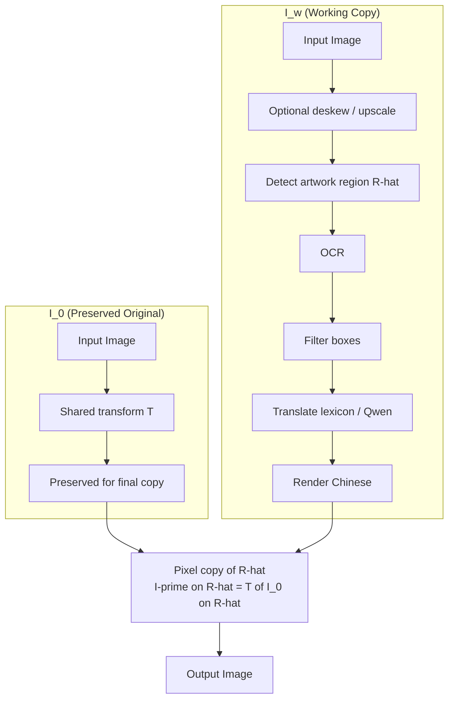
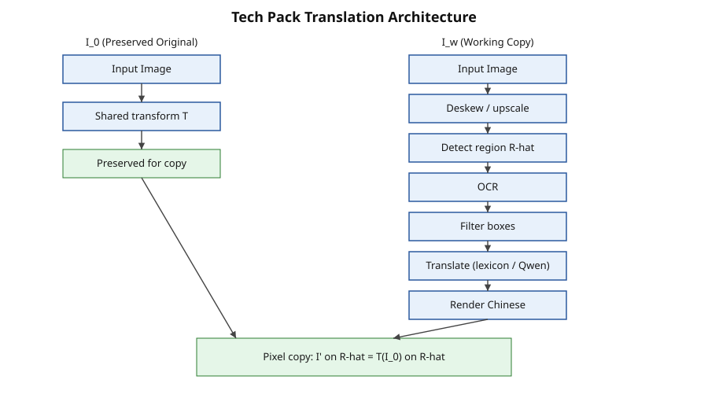

# Architecture

Two images are maintained:

- \( I_0 \): preserved original (receives only the same global geometric transform \( T \) as the working copy);
- \( I_w \): working copy used for detection, recognition, translation and rendering.

After rendering, the constraint

\[
I'|_{\hat{R}} = (T(I_0))|_{\hat{R}}
\]

is realized by direct pixel copy.

Optional modules never write inside \( \hat{R} \) once the copy has been performed.

Full detail is in `ALGORITHM.md`. Pipeline: `docs/pipeline.md`.
