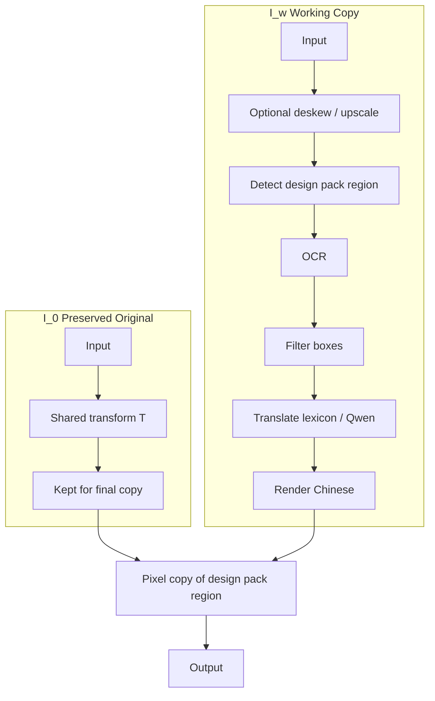

# Tech Pack Translator

Answers to the interview task: translate necessary text in a garment tech pack image to Chinese, while leaving the design pack image unchanged.

## 1. Challenges

| Challenge | Why it is difficult |
|-----------|---------------------|
| Design pack image must stay pixel-identical | It is printed on the garment. Any change is a defect. Its position is not fixed across packs. |
| Mixed content | Tables, free notes, call-outs and line drawings sit on the same page. A single OCR pass is not enough. |
| Text length changes | Chinese is usually shorter; some phrases expand. Layout can break. |
| Domain terms | Fit block, topstitch, YKK codes, fabric compositions. Generic translation is inconsistent. |
| Scan quality | Watermarks, low resolution, skew, coloured or handwritten notes. |
| Reconstruction | Replacing text must not damage table lines or technical drawings. |

## 2. Algorithm (diagram)

Two images are kept:

- \( I_0 \): preserved original
- \( I_w \): working copy

After translation and rendering we enforce

\[
I'|_{\hat{R}} = (T(I_0))|_{\hat{R}}
\]

by copying the artwork pixels back. \( \hat{R} \) is the design pack region (user mask or right-side heuristic). \( T \) is an optional shared geometric transform (deskew / upscale).




Full pipeline:


See also [ALGORITHM.md](ALGORITHM.md) and [docs/pipeline.md](docs/pipeline.md).

### Special cases (short)

Handled in code: overlap with design pack, already-Chinese text, low confidence, very small text, watermarks, overflow (adaptive font), API failure (lexicon fallback), deskew alignment (PSNR stays infinite).

Partial / open: per-box rotation, full table structure, multiple artwork regions (union of masks supported), learned detector, end-to-end VLM, embedding RAG.  
None of these are allowed to write inside the design pack region after the final copy.

## 3. Runnable project

```bash
git clone https://github.com/Johnnypoon1024917/techpack-translator.git
cd techpack-translator
pip install -r requirements.txt
python -m app.web_demo          # http://localhost:7860
```

Docker:

```bash
docker compose up web           # Gradio on :7860
docker compose up api           # FastAPI on :8000
```

CLI:

```python
from app.core import process_techpack
process_techpack("samples/sample_techpack.jpg", "out.jpg")
```

Qwen (optional):

```bash
export DASHSCOPE_API_KEY=sk-...
```

Without the key the code uses the built-in glossary.

## Notes on the design pack image

- Detected by user mask (preferred) or a right-side heuristic. Position may vary; the mask removes that assumption.
- Final step copies the original pixels of that region back. Measured PSNR on the region is infinite (tested with and without deskew).
- Translation uses a small apparel glossary plus optional Qwen. Either satisfies the “API or own model” requirement.

## Layout

- `app/core.py` — pipeline, filtering, pixel copy
- `app/advanced.py` — deskew, inpainting, metrics, multi-mask
- `app/api.py` — FastAPI
- `app/web_demo.py` — Gradio
- `ALGORITHM.md` — formulation and special-case analysis
- `docs/` — architecture and pipeline diagrams (Mermaid + SVG)
