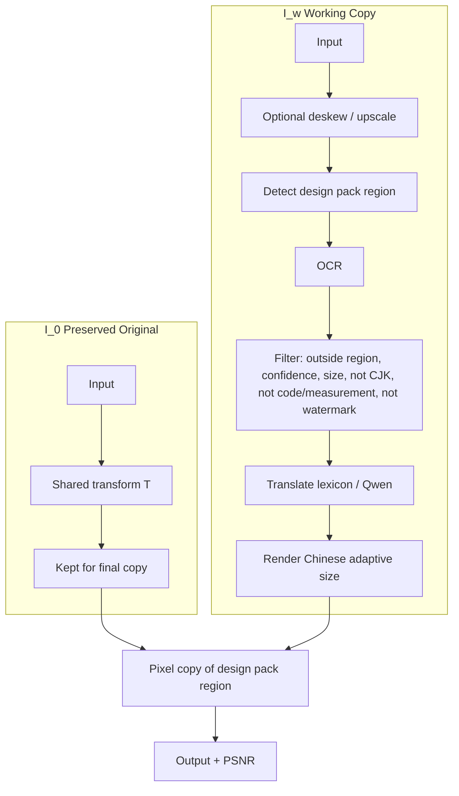

# Tech Pack Translator

Answers to the interview task: translate necessary text in a garment tech pack image to Chinese, while leaving the design pack image unchanged.

## 1. Challenges

| Challenge | Why it is difficult | How it is handled on this sample |
|-----------|---------------------|----------------------------------|
| Design pack image must stay pixel-identical | Printed on the garment. Position varies. | Final pixel copy from preserved original. PSNR on the region is infinite. |
| Artwork-internal text vs annotations | Top-right graphic contains “RAMESES II”, “Kings of Egypt II”, “VIEW OF HEAD”. These must not be translated. Bottom pants sketch has “Design pack image” labels that are placeholders. | Region mask excludes the artwork before OCR filtering. Labels outside the mask can be translated. |
| Non-translatable table content | YKK codes, measurements (5.5 oz, 60", 1/8"), quantities, “N/A”, colour names used as proper nouns. | Preserve pattern skips codes and measurements. Glossary controls colour-name handling. |
| Empty header fields | Style Name, Brand, Designer are blank. | Only labels are translated; empty values are left empty. |
| Mixed content | Tables, call-outs, drawings. | OCR + box filter; drawings outside the mask are untouched. |
| Text length change | Chinese shorter or longer. | Adaptive font size inside the original box. |
| Domain terms | Fit block, topstitch, piping, etc. | Apparel glossary + optional Qwen. |
| Scan quality | Skew, watermarks, low contrast. | Deskew (shared transform), watermark filter, confidence gate. |

Full policy: [docs/POLICY.md](docs/POLICY.md).

## 2. Algorithm

Two images:

- \( I_0 \): preserved original
- \( I_w \): working copy

After rendering:

\[
I'|_{\hat{R}} = (T(I_0))|_{\hat{R}}
\]

\( \hat{R} \) = design pack region (user mask preferred; right-side heuristic fallback).  
\( T \) = optional shared geometric transform.




Detail: [ALGORITHM.md](ALGORITHM.md), [docs/pipeline.md](docs/pipeline.md).

### Special cases

Handled: overlap with artwork, already-Chinese, low confidence, small text, watermarks, overflow, API failure, deskew alignment, codes/measurements preserved.  
Partial: per-box rotation, full table model, multi-region (union supported), learned detector, VLM path, embedding RAG.  
None write inside the artwork region after the final copy.

## 3. Runnable project

```bash
git clone https://github.com/Johnnypoon1024917/techpack-translator.git
cd techpack-translator
pip install -r requirements.txt
python -m app.web_demo
```

Docker:

```bash
docker compose up web     # :7860
docker compose up api     # :8000
```

Check on the sample:

```bash
python -m app.eval_sample
```

## 4. Result on the provided sample

- Translated boxes: 61  
- Flagged: 183  
- Protected-region PSNR: **infinite**  
- Protected bbox: (930, 5, 1490, 469)  
- Output: `docs/sample_output.jpg`

### Flag breakdown (183 total)

| Reason | Count | Meaning |
|--------|-------|---------|
| no_translation | 136 | Codes, measurements, numbers, or strings outside glossary (correctly left unchanged) |
| low_confidence | 36 | OCR confidence below threshold; flagged for review |
| likely_vertical | 9 | Aspect ratio suggests vertical text |
| too_small | 2 | Height < 8 px |
| **Total flagged** | **183** | |

The 136 “no_translation” items are mostly YKK codes, oz/inch measurements, pure numbers, and short tokens that the preserve filter or glossary correctly rejected. They are not missed table cells.

### Example translations

| Original | Chinese |
|----------|---------|
| Placement | 位置 |
| Quantity | 数量 |
| Main Fabric | 主面料 |
| Yards | 码 |
| USE HEAVY THREAD FOR ALL TOPSTITCHING | 所有明线使用重线 |
| Piping Cord | 滚边绳 |
| Blue Light | 浅蓝 |
| As Per Requirement | 按要求 |

Full BOM-style fragments that appear in the sample (after OCR) are handled by the same glossary + preserve rules. Codes such as “YKK: 316” and measurements such as “5.5 oz” or “60"” are left unchanged.

### Visual

Before (original sample) and after (translated, protected region outlined in red) are generated by:

```bash
python -m app.eval_sample
```

The output image is written to `docs/sample_output.jpg`. The top-right artwork region remains pixel-identical (PSNR infinite).

## 5. Evaluation and tests

```bash
python -m app.eval_sample          # metrics + flag breakdown
python tests/test_pipeline.py      # automated checks
```

**Test coverage** (`tests/test_pipeline.py`):
- Protected-region PSNR is infinite  
- Known codes are not translated  
- Artwork strings (RAMESES, Kings of Egypt, VIEW OF HEAD) do not appear in translations  
- Output file is written  

**Failure cases**: see [docs/FAILURES.md](docs/FAILURES.md).

**Region detection**  
- User mask (preferred)  
- Right-side heuristic (default)  
- `detect_artwork_by_density` in `advanced.py` (text density + variance, less position-dependent)  
- Learned detector remains open; IoU helper is provided for future measurement.

## Discussion questions

These are the formal questions the current design leaves open. A qualified response should derive the bound, the threshold, or the identification condition.

**1. Finite-sample generalization**

Let \(\mathcal{H}\) be a detector class with VC dimension \(d = \mathrm{VC}(\mathcal{H})\). Let \(S\) be \(n\) labeled packs drawn i.i.d. from \(D\). Let \(\mathrm{err}_D(h)\) be true error on a new factory and \(\mathrm{err}_S(h)\) be empirical error.

State the PAC bound you are using. For \(n < 50\), what is the numerical value of the bound, and is it vacuous? What \(n\) would you need to guarantee \(\mathrm{err}_D(h) \le \mathrm{err}_S(h) + 0.01\) with probability \(0.95\)?

**2. Bayes-optimal decision and calibration**

Let \(Y = 1\) if a region is artwork \(R\), \(Y = 0\) otherwise. Let \(L(0,1) = C_{FN}\) be the cost of a false negative (reprint) and \(L(1,0) = C_{FP}\) be the cost of a false positive (one human review).

Derive the Bayes-optimal classifier. Then prove that thresholding an uncalibrated score \(f(x)\) at that threshold does not in general minimize expected risk. What distribution-free procedure gives a finite-sample guarantee on \(P(\text{artwork overwritten})\) without assuming calibration?

**3. Causal attribution in the pipeline**

Model the pipeline as a structural causal model \(X \to O \to T \to R \to Y\), where \(O\) is OCR output, \(T\) is translation, \(R\) is rendering, and \(Y\) is final quality. Let \(U_O, U_T, U_R\) be exogenous noise.

If end-to-end quality \(Y\) improves after you change \(T\), how do you identify the causal effect of \(T\) on \(Y\), holding \(O\) fixed? Show why the observational contrast \(\mathbb{E}[Y \mid T = 1] - \mathbb{E}[Y \mid T = 0]\) does not identify it, and state the \(do\)-intervention you need.

## Notes

- Design pack image: user mask or right-side heuristic. Final step copies original pixels. Position variation is handled by the mask.  
- Translation: glossary (offline) or Qwen (`DASHSCOPE_API_KEY`).  
- Empty headers: labels translated, values left blank.  
- Artwork text (RAMESES II etc.): inside protected region, never modified.
