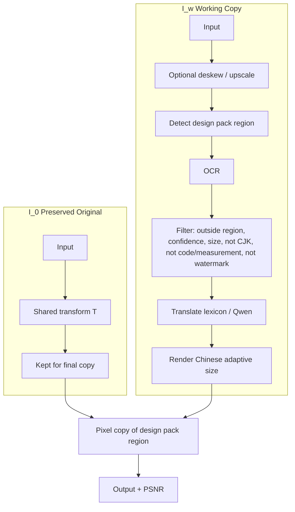

# Tech Pack Translator

Answers to the interview task: translate necessary text in a garment tech pack image to Chinese, while leaving the design pack image unchanged.

## 1. Challenges

| Challenge | Why it is difficult | How it is handled on this sample |
|-----------|---------------------|----------------------------------|
| Design pack image must stay pixel-identical | Printed on the garment. Position varies. | Final pixel copy from preserved original. PSNR on the region is infinite. |
| Artwork-internal text vs annotations | Top-right graphic contains “RAMESES II”, “Kings of Egypt II”, “VIEW OF HEAD”. These must not be translated. Bottom pants sketch has “Design pack image” labels that are placeholders. | Region mask excludes the artwork before OCR filtering. Labels outside the mask can be translated. |
| Non-translatable table content | YKK codes, measurements (5.5 oz, 60", 1/8"), quantities, “N/A”, colour names used as proper nouns. | Preserve pattern skips codes and measurements. Glossary controls colour-name handling. |
| Empty header fields | Style Name, Brand, Designer are blank. | Only labels are translated; empty values are left empty. |
| Mixed content | Tables, call-outs, drawings. | OCR + box filter; drawings outside the mask are untouched. |
| Text length change | Chinese shorter or longer. | Adaptive font size inside the original box. |
| Domain terms | Fit block, topstitch, piping, etc. | Apparel glossary + optional Qwen. |
| Scan quality | Skew, watermarks, low contrast. | Deskew (shared transform), watermark filter, confidence gate. |

Full policy: [docs/POLICY.md](docs/POLICY.md).

## 2. Algorithm

Two images:

- \( I_0 \): preserved original
- \( I_w \): working copy

After rendering:

\[
I'|_{\hat{R}} = (T(I_0))|_{\hat{R}}
\]

\( \hat{R} \) = design pack region (user mask preferred; right-side heuristic fallback).  
\( T \) = optional shared geometric transform.




Detail: [ALGORITHM.md](ALGORITHM.md), [docs/pipeline.md](docs/pipeline.md).

### Special cases

Handled: overlap with artwork, already-Chinese, low confidence, small text, watermarks, overflow, API failure, deskew alignment, codes/measurements preserved.  
Partial: per-box rotation, full table model, multi-region (union supported), learned detector, VLM path, embedding RAG.  
None write inside the artwork region after the final copy.

## 3. Runnable project

```bash
git clone https://github.com/Johnnypoon1024917/techpack-translator.git
cd techpack-translator
pip install -r requirements.txt
python -m app.web_demo
```

Docker:

```bash
docker compose up web     # :7860
docker compose up api     # :8000
```

Check on the sample:

```bash
python -m app.eval_sample
```

## 4. Result on the provided sample

- Translated boxes: 61  
- Flagged (low confidence / small / watermark / vertical): 183  
- Protected-region PSNR: **infinite**  
- Output image: run `python -m app.eval_sample` to regenerate `docs/sample_output.jpg`

Example translations from the run:

- Placement → 位置  
- Quantity → 数量  
- Main Fabric → 主面料  
- Yards → 码  
- USE HEAVY THREAD… → 所有明线使用重线  
- Piping → 滚边绳  

Codes and measurements (YKK numbers, oz, inches) were left unchanged by the preserve filter.

## 5. Evaluation

```bash
python -m app.eval_sample
```

Prints translated count, flag breakdown, protected bbox, PSNR, and sample translation pairs.  
Primary metric is PSNR on \( \hat{R} \) (target ∞). Secondary metrics (chrF/COMET, cell IoU) need a labeled set and are not automated yet.

## Notes

- Design pack image: user mask or right-side heuristic. Final step copies original pixels. Position variation is handled by the mask.  
- Translation: glossary (offline) or Qwen (`DASHSCOPE_API_KEY`).  
- Empty headers: labels translated, values left blank.  
- Artwork text (RAMESES II etc.): inside protected region, never modified.
