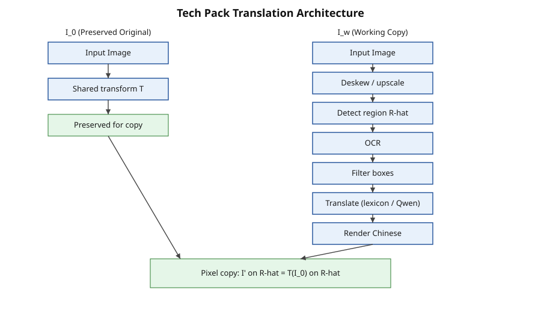
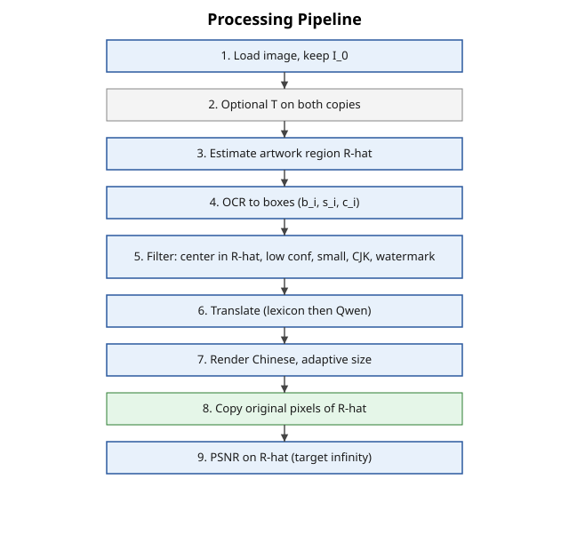

# Tech Pack Translator

A system that translates necessary text in a garment tech pack image to Chinese, while leaving the design pack image pixel-identical.

This repository answers the interview task: identify the challenges, design an algorithm, and provide runnable code.

## 1. Challenges

| Challenge | Why it is difficult | How it is handled on this sample |
|-----------|---------------------|----------------------------------|
| Design pack image must stay pixel-identical | It is printed on the garment. Its position can vary. | The original pixels are copied back at the end. PSNR on the region is infinite. |
| Artwork text vs annotation text | The top-right graphic contains “RAMESES II”, “Kings of Egypt II”, and “VIEW OF HEAD”. These must not be translated. Labels on the pants sketch are placeholders. | The artwork region is masked before translation. Text outside the mask can be translated. |
| Codes and measurements | YKK codes, sizes (5.5 oz, 60", 1/8"), quantities, and “N/A” must stay unchanged. | A preserve pattern skips them. |
| Empty header fields | Style Name, Brand, and Designer are blank. | Only the labels are translated. Empty values are left empty. |
| Mixed content | Tables, call-outs, and drawings appear together. | OCR is filtered by region, confidence, size, and content type. |
| Text length changes | Chinese is often shorter or longer than English. | Font size is adjusted to fit the original box. |
| Domain terms | Fit block, topstitch, piping, etc. | An apparel glossary is used, with an optional Qwen fallback. |
| Scan quality | Skew, watermarks, and low contrast are common. | Deskew (with shared transform), watermark filter, and confidence gate. |

Full policy: [docs/POLICY.md](docs/POLICY.md).

## 2. Algorithm

Two images are kept:

- \( I_0 \): the preserved original
- \( I_w \): the working copy

After rendering, the design pack region is restored by copying:

\[
I'|_{\hat{R}} = (T(I_0))|_{\hat{R}}
\]

where \(\hat{R}\) is the design pack region and \(T\) is any shared geometric transform (for example, deskew).

```mermaid
flowchart TB
    subgraph Original["Preserved Original"]
        A1[Input] --> A2[Shared transform]
        A2 --> A3[Kept for final copy]
    end
    subgraph Working["Working Copy"]
        B1[Input] --> B2[Optional deskew / upscale]
        B2 --> B3[Detect design pack region]
        B3 --> B4[OCR]
        B4 --> B5[Filter: outside region, confidence, size, not CJK, not code/measurement]
        B5 --> B6[Translate (glossary / Qwen)]
        B6 --> B7[Render Chinese]
    end
    A3 --> C[Copy design pack pixels]
    B7 --> C
    C --> D[Output + PSNR]
```





More detail: [ALGORITHM.md](ALGORITHM.md), [docs/pipeline.md](docs/pipeline.md).

### Special cases

Handled: overlap with artwork, already-Chinese text, low confidence, small text, watermarks, overflow, API failure, deskew alignment, and preservation of codes/measurements.  
Partial: per-box rotation, full table structure, multiple artwork regions (union is supported), learned detector, end-to-end VLM, and embedding-based retrieval.  
None of these paths write inside the artwork region after the final copy.

## 3. How to run

```bash
git clone https://github.com/Johnnypoon1024917/techpack-translator.git
cd techpack-translator
pip install -r requirements.txt
python -m app.web_demo
```

Docker:

```bash
docker compose up web     # Gradio on :7860
docker compose up api     # FastAPI on :8000
```

Check the sample:

```bash
python -m app.eval_sample
python tests/test_pipeline.py
```

## 4. Result on the sample

- Translated boxes: 61  
- Flagged boxes: 183  
- Protected-region PSNR: infinite  
- Protected region: (930, 5, 1490, 469)  
- Output image: `docs/sample_output.jpg`

### Why 183 boxes were flagged

| Reason | Count | Meaning |
|--------|-------|---------|
| no_translation | 136 | Codes, measurements, numbers, or strings outside the glossary (left unchanged) |
| low_confidence | 36 | OCR confidence below threshold |
| likely_vertical | 9 | Aspect ratio suggests vertical text |
| too_small | 2 | Height under 8 px |
| **Total** | **183** | |

Most of the 136 “no_translation” items are YKK codes, ounce/inch measurements, and pure numbers. They were correctly left alone.

### Example translations

| Original | Chinese |
|----------|---------|
| Placement | 位置 |
| Quantity | 数量 |
| Main Fabric | 主面料 |
| Yards | 码 |
| USE HEAVY THREAD FOR ALL TOPSTITCHING | 所有明线使用重线 |
| Piping Cord | 滚边绳 |
| Blue Light | 浅蓝 |
| As Per Requirement | 按要求 |

Codes such as “YKK: 316” and measurements such as “5.5 oz” or “60"” are left unchanged.

### Visual check

Run `python -m app.eval_sample` to regenerate `docs/sample_output.jpg`.  
The top-right artwork region is outlined in red and remains pixel-identical to the original.

## 5. Tests and evaluation

```bash
python -m app.eval_sample          # metrics and flag breakdown
python tests/test_pipeline.py      # automated checks
```

The tests check that:

- PSNR on the artwork region is infinite  
- Known codes are not translated  
- Artwork strings (RAMESES, Kings of Egypt, VIEW OF HEAD) do not appear in the translations  
- The output file is written  

Known failure modes are listed in [docs/FAILURES.md](docs/FAILURES.md).

Region detection currently uses:

- A user-supplied mask (preferred)  
- A right-side heuristic (default)  
- A density-based fallback in `advanced.py`  

A learned detector is still open. An IoU helper is included for future measurement.

## Discussion questions

These questions are left open by the current design. A precise answer should derive the bound, the threshold, or the identification condition.

**1. Finite-sample generalization**

Let \(\mathcal{H}\) be a detector class with VC dimension \(d\). Let \(S\) be \(n\) labeled packs drawn i.i.d. from \(D\). Let \(\mathrm{err}_D(h)\) be the true error on a new factory and \(\mathrm{err}_S(h)\) the empirical error.

State the PAC bound you are using. For \(n < 50\), is the bound vacuous? What \(n\) would you need to guarantee \(\mathrm{err}_D(h) \le \mathrm{err}_S(h) + 0.01\) with probability 0.95?

**2. Bayes-optimal decision and calibration**

Let \(Y = 1\) if a region is artwork and \(Y = 0\) otherwise. Let \(C_{FN}\) be the cost of a false negative (reprint) and \(C_{FP}\) the cost of a false positive (one human review).

Derive the Bayes-optimal classifier. Show that thresholding an uncalibrated score at that threshold does not in general minimize expected risk. What distribution-free procedure gives a finite-sample guarantee on the probability of artwork being overwritten, without assuming calibration?

**3. Causal attribution**

Model the pipeline as \(X \to O \to T \to R \to Y\), where \(O\) is OCR, \(T\) is translation, \(R\) is rendering, and \(Y\) is final quality.

If end-to-end quality improves after you change the translation module, how do you identify the causal effect of translation while holding OCR fixed? Why does the observational contrast not identify it, and what intervention do you need?

## Notes

- Design pack image: user mask or right-side heuristic. Final step copies original pixels.  
- Translation: offline glossary, or Qwen if `DASHSCOPE_API_KEY` is set.  
- Empty headers: labels are translated, values are left blank.  
- Artwork text (RAMESES II and similar): inside the protected region, never modified.

## Last remark

The interview question itself leaves four gaps.

1. **The objective is underspecified.**  
   The pixel constraint is stated, but no target translation map or loss is given. Any map that leaves strings inside the artwork region untouched satisfies the written requirement.

2. **Generalization cannot be measured.**  
   Only one sample is supplied. With a single example, every uniform convergence bound is vacuous. Variation in artwork position is mentioned but not shown.

3. **No decision criterion is given.**  
   The relative cost of a reprint versus a human review is never stated. Without that ratio, every operating point is admissible.

4. **The source of improvement is not identified.**  
   An end-to-end gain does not show whether it came from OCR, translation, or rendering. No intervention that isolates one module is requested.

A solution can meet every stated requirement while remaining silent on all four points. That is a property of the question.
